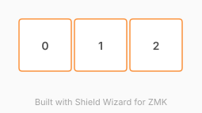

# ZMK Configuration for whomst

*Generated by Shield Wizard for ZMK*



Download compiled firmware from the Actions tab. <https://zmk.dev/docs/user-setup#installing-the-firmware>

Edit your keymap <https://zmk.dev/docs/keymaps>.
User keymap is located at [`config/whomst.keymap`](config/whomst.keymap).

-----

<details>
<summary>
Shield Wizard Debug Information
</summary>

In case of broken configuration, here is the Shield Wizard internal data used to generate this configuration:

Commit: 84a348b08cf4fec4a5441a46147e9a345b10ffab

```json
{"name":"whomst","shield":"whomst","dongle":false,"modules":["badjeff/pmw3610"],"layout":[{"id":"01M4J089KY7C2AR9F1F39NP6PP","part":0,"row":0,"col":0,"w":1,"h":1,"x":0,"y":0,"r":0,"rx":0,"ry":0},{"id":"01M4J08E42XVCGYEFV4EK87WTE","part":0,"row":0,"col":1,"w":1,"h":1,"x":1,"y":0,"r":0,"rx":0,"ry":0},{"id":"01M4J08J3SSM12A49WC1TN53G4","part":0,"row":0,"col":2,"w":1,"h":1,"x":2,"y":0,"r":0,"rx":0,"ry":0}],"parts":[{"name":"unibody","controller":"nice_nano_v2","pins":{"d2":{"usage":"kscan","kscan":"01M4J0BQJ58TRWPSE9J1CXYZYJ","role":"input"},"d3":{"usage":"kscan","kscan":"01M4J0BQJ58TRWPSE9J1CXYZYJ","role":"input"},"d4":{"usage":"kscan","kscan":"01M4J0BQJ58TRWPSE9J1CXYZYJ","role":"input"},"d14":{"usage":"bus","bus":"spi0","role":"sck"},"d15":{"usage":"bus","bus":"spi0","role":"miosio"},"d18":{"usage":"device","deviceId":"01M4J0CXQG23QNXSPWTW4KEJZK","role":"cs"},"d19":{"usage":"device","deviceId":"01M4J0CXQG23QNXSPWTW4KEJZK","role":"irq"}},"kscans":[{"kind":"direct","id":"01M4J0BQJ58TRWPSE9J1CXYZYJ","mode":"gnd"}],"keys":{"01M4J089KY7C2AR9F1F39NP6PP":{"input":"d2"},"01M4J08E42XVCGYEFV4EK87WTE":{"input":"d3"},"01M4J08J3SSM12A49WC1TN53G4":{"input":"d4"}},"encoders":[],"buses":{"spi0":{"type":"spi","devices":[{"id":"01M4J0CXQG23QNXSPWTW4KEJZK","type":"pmw3610","cpi":600,"swapxy":false,"invertx":false,"inverty":false}]}}}]}
```

</details>
